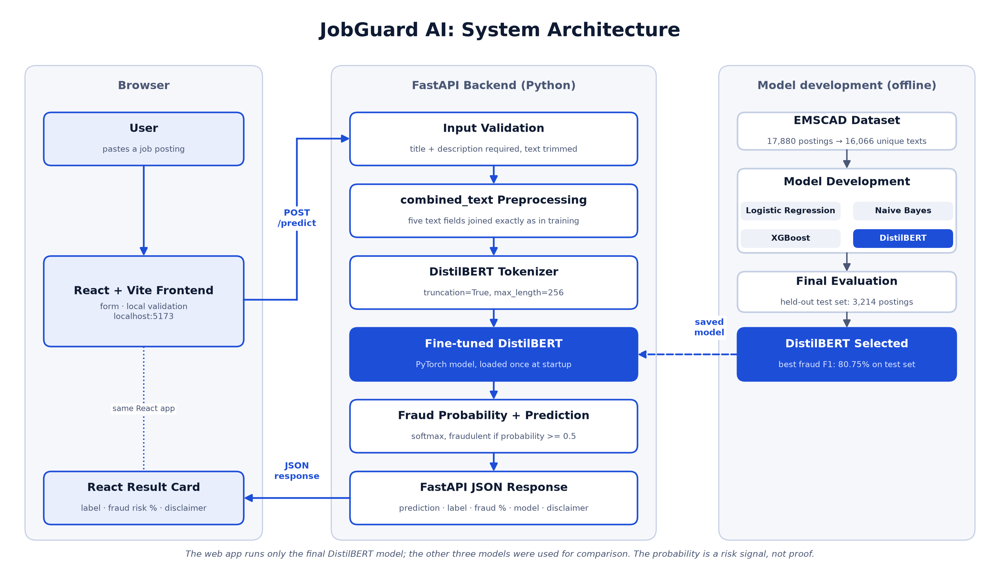

# JobGuard AI: Detecting Fraudulent Job Postings Using Machine Learning and NLP

An undergraduate Machine Learning course project. JobGuard AI reads the text of a job posting and predicts whether it is **legitimate** or **fraudulent**.

> **Disclaimer:** JobGuard AI is an educational project. Its predictions are not definitive proof that a job posting is real or fake.

## Problem

Online job boards contain fake postings that try to steal personal information or money from job seekers. Checking every posting by hand is not practical. This project asks: *can a machine-learning model learn the language patterns of fraudulent postings?*

## Dataset

**EMSCAD** (Employment Scam Aegean Dataset), about 17,880 labeled job ads.

- Target column: `fraudulent` (`0` = legitimate, `1` = fraudulent)
- Text columns: `title`, `company_profile`, `description`, `requirements`, `benefits`
- Other columns: `location`, `department`, `salary_range`, `employment_type`, `required_experience`, `required_education`, `industry`, `function`, `telecommuting`, `has_company_logo`, `has_questions`
- Fraudulent postings are rare (a small minority of the data), so this is a **class-imbalance** problem.

The CSV is **not** included in this repository. Put it at:

```
data/raw/fake_job_postings.csv
```

(This is the file name used by the popular Kaggle copy of EMSCAD, "Real / Fake Job Posting Prediction".)

## Models compared (final model: DistilBERT)

| # | Model | Features | Type |
|---|-------|----------|------|
| 1 | Logistic Regression | TF-IDF | Traditional |
| 2 | Multinomial Naive Bayes | TF-IDF | Traditional |
| 3 | XGBoost | TF-IDF | Advanced |
| 4 | DistilBERT (fine-tuned) | Raw text tokens | Advanced |

Because fraud is rare, accuracy alone is misleading. Every model is evaluated with accuracy, precision, recall, F1-score, and a confusion matrix, with special attention to the **fraudulent class**. The **selected final model is the fine-tuned DistilBERT** (see "Final results" below).

**ML pipeline in one line:** clean and deduplicate the data, build `combined_text`, split 80/20 (stratified), choose each model's settings on a validation split carved out of the training data only, retrain on all training data, then evaluate once on the held-out test set.

## Preprocessing (leakage-safe)

Run `notebooks/02_data_preprocessing.ipynb` to create `data/processed/train.csv` and `data/processed/test.csv`. The steps, in order:

1. **Remove duplicate rows**, ignoring `job_id` (keep the first copy).
2. **Fill missing text** in `title`, `company_profile`, `description`, `requirements`, `benefits` with empty strings (no rows dropped).
3. **Create `combined_text`** with a label before each part (`TITLE: ...`, `COMPANY PROFILE: ...`, and so on). No stemming or stop-word removal.
4. **Remove repeated `combined_text`** (keep the first). Two postings can have identical text but different metadata such as location, so removing duplicate *rows* is not enough: if one twin were in training and the other in testing, the model would be tested on text it had already seen and the scores would look too good. The code first checks that identical texts never have conflicting labels, and stops if they do.
5. **Stratified 80/20 split** (`random_state=42`) so train and test keep the same fraud percentage.
6. **Validate** (no missing inputs, target only 0/1, no `job_id`, no row overlap, **0 identical texts in both train and test**) and save the two CSV files.

Processed files contain `combined_text`, `telecommuting`, `has_company_logo`, `has_questions`, and `fraudulent`.

## Project structure

```
JobGuard AI/
├── data/
│   ├── raw/            # original EMSCAD CSV (you add this, never edited)
│   └── processed/      # cleaned data / train-test splits created by our code
├── notebooks/
│   ├── 01_data_exploration.ipynb
│   ├── 02_data_preprocessing.ipynb
│   ├── 03_logistic_regression.ipynb
│   ├── 04_naive_bayes.ipynb
│   ├── 05_xgboost.ipynb
│   ├── 06_distilbert.ipynb          # local (Apple MPS) version, too slow to run here, not executed
│   ├── 06_distilbert_colab.ipynb    # the version to RUN: Google Colab, CUDA GPU
│   └── 07_final_model_evaluation.ipynb   # final locked test-set comparison + final model choice
├── src/                # reusable Python code shared by notebooks and the app
│   ├── preprocessing.py
│   ├── evaluation.py
│   └── predict.py
├── models/             # saved trained models
├── backend/            # FastAPI backend serving the final DistilBERT model
│   ├── main.py
│   ├── model_service.py
│   ├── intake_parser.py        # smart intake: pasted posting -> the five fields (rules only)
│   ├── scam_signals.py         # warning-sign scanner: fixed text rules, independent of the model
│   ├── url_importer.py         # job URL import: safe fetcher (SSRF protections) + page text extraction
│   ├── verification.py         # verification checks on URL / contact metadata (facts, no score)
│   ├── schemas.py
│   ├── demo_pages.py           # hand-written pages for the controlled demo and tests (no real internet)
│   ├── demo_import_server.py   # the real API with only the page download replaced by those pages
│   ├── test_api.py
│   ├── test_intake_parser.py
│   ├── test_scam_signals.py
│   ├── test_url_importer.py
│   └── test_verification.py
├── frontend/           # React + Vite web app (talks to the backend)
│   ├── src/
│   │   ├── components/ # Header, Analyzer, UrlPanel, DetectedDetails, PredictionResult, SignalPanel, VerificationPanel, HowItWorks, ModelPerformance, AboutProject
│   │   ├── services/   # api.js (all fetch calls to FastAPI)
│   │   ├── examples.js # hand-written demo postings (pasted as one block of text)
│   │   ├── App.jsx, App.css, index.css, main.jsx
│   ├── .env.example    # VITE_API_URL
│   └── package.json
├── app/
│   └── app.py          # Streamlit demo
├── docs/               # presentation material (facts, code snippets, demo script, asset guide, project freeze)
├── results/
│   ├── figures/        # charts, architecture diagram and app screenshots for the report and slides
│   └── metrics/        # metric tables (CSV) from real runs
├── requirements.txt
├── README.md
└── .gitignore
```

## Setup

> **macOS note:** XGBoost needs the OpenMP library: run `brew install libomp` once.

```bash
python3 -m venv .venv
source .venv/bin/activate
pip install -r requirements.txt
jupyter notebook
```

Then open `notebooks/01_data_exploration.ipynb`.

## Roadmap

- [x] **Milestone 1:** Project structure and starter files
- [x] **Milestone 2:** Dataset exploration (`notebooks/01_data_exploration.ipynb`)
- [x] **Milestone 3:** Prepare the dataset (`notebooks/02_data_preprocessing.ipynb`, `src/preprocessing.py`): remove duplicates, `combined_text`, stratified train/test split
- [x] **Milestone 4:** TF-IDF and Logistic Regression (`notebooks/03_logistic_regression.ipynb`, saved pipeline in `models/`)
- [x] **Milestone 5:** Multinomial Naive Bayes, with a validation-based model-selection protocol (`notebooks/04_naive_bayes.ipynb`)
- [x] **Milestone 6:** XGBoost (TF-IDF), validation-based (`notebooks/05_xgboost.ipynb`)
- [x] **Milestone 7:** DistilBERT fine-tuning, validation-based. Training on the local Mac (Apple MPS) was too slow, so it was run on Google Colab (CUDA GPU) with `notebooks/06_distilbert_colab.ipynb` (only `train.csv` was uploaded, never `test.csv`). The final model, retrained on all of `train.csv`, is in `models/distilbert/`
- [x] **Milestone 8:** Final locked model comparison on the held-out test set (`notebooks/07_final_model_evaluation.ipynb`). The selected model is recorded in `results/metrics/final_model_decision.csv` and **`src/final_model_config.json`** (the file the backend should read to know which model to load)
- [x] **Milestone 9:** FastAPI backend around the final DistilBERT model (`backend/`, see "Backend API" below)
- [x] **Milestone 10:** React + Vite frontend (`frontend/`, see "Frontend" below)
- [x] **Milestone 11:** Final polish, end-to-end testing, and presentation material collected in `docs/` and `results/figures/`. The project is **frozen** (see `docs/project_freeze.md`): no further model tuning
- [x] **Milestone 12:** Productization and smart intake. Users now paste a whole job posting; a deterministic rule-based parser (`backend/intake_parser.py`) splits it into the five fields the model was trained on. The model, threshold and preprocessing did not change (see "Smart intake" below and `docs/productization_notes.md`)
- [x] **Milestone 13:** Transparent job-scam signal scanner. A deterministic rule engine (`backend/scam_signals.py`) quotes concrete warning signs found in the pasted text and suggests what to verify. It runs **beside** DistilBERT, never feeds it, and does not explain its score. The model, threshold and preprocessing did not change (see "Warning-sign scanner" below and `docs/scam_signal_engine.md`)
- [x] **Milestone 14:** Job URL import and identity verification. Users can give a job link instead of pasting text. A safe fetcher (`backend/url_importer.py`) reads the public page, and a third independent layer (`backend/verification.py`) reports facts about where the job is hosted and whether the optional company website and recruiter email line up. Verification has no score and never feeds the model. The model, threshold and preprocessing did not change (see "Job URL import and verification" below and `docs/job_verification.md`)
- [ ] **Next:** Create the presentation

## Backend API

The final model (DistilBERT, chosen in Milestone 8) is served by a small FastAPI backend:

```
React frontend (frontend/)
    | JSON POST /predict   (a pasted posting, or the five fields)
FastAPI backend (backend/main.py)
    | pasted posting -> smart intake parser (backend/intake_parser.py) -> the five fields
    |   \-> warning-sign scanner (backend/scam_signals.py): fixed rules on the same text, separate from the model
    | builds the same combined_text used in training (src/preprocessing.create_combined_text)
saved JobGuard DistilBERT tokenizer + model (models/distilbert/, loaded ONCE at startup)
    | tokenize (truncation, max_length=256) -> logits -> softmax
fraud probability  ->  threshold 0.5  ->  JSON response (+ the scanner's signals)
```

Only the selected DistilBERT model is loaded; Logistic Regression, Naive Bayes and XGBoost are not imported by the backend. The model is read from the **local** folder `models/distilbert/` (never downloaded), and the backend refuses to start with a clear error if its files are missing. `src/final_model_config.json` is checked at startup.

**Install and run** (from the project root, with the virtual environment active):

```bash
pip install -r requirements.txt
uvicorn backend.main:app --reload
```

The API then runs at **http://127.0.0.1:8000**, with interactive documentation (Swagger UI) at **http://127.0.0.1:8000/docs**. Inference uses CUDA, then Apple MPS, then CPU; a GPU is not required. To force a device: `JOBGUARD_DEVICE=cpu uvicorn backend.main:app`.

| Endpoint | Purpose |
|---|---|
| `GET /` | API status: `{"name": "JobGuard AI API", "status": "running"}` |
| `GET /health` | `status`, `model_loaded`, `model`, and the inference `device` |
| `POST /predict` | Takes a job posting, returns the model's risk signal |
| `POST /extract` | Runs only the smart intake parser (no model) and returns the five detected fields |
| `POST /import-url` | Safely fetches a public job page and returns its text, its source and the verification checks (no model; the frontend then sends the text to `/predict`) |

`POST /predict` accepts **either** of two request styles (never both in one request):

1. **A pasted posting** (what the website sends): `{"raw_posting": "<the whole posting text>"}`. The backend splits it into the five fields with the smart intake parser (next section), then continues exactly as below.
2. **The five fields** (the original format, still fully supported). At least one field must contain text. Fields that are omitted or empty are treated as empty. Each field is limited to 50,000 characters; `raw_posting` too. Sending `raw_posting` together with any separate field, or sending no text at all, gets a `422`.

Example of the five-field style:

```json
{
  "title": "Customer Support Representative",
  "company_profile": "Example Co. provides billing software to small businesses.",
  "description": "Answer customer questions by email and chat.",
  "requirements": "Good written English.",
  "benefits": "Paid vacation."
}
```

Response (a real response from this API for a hand-written suspicious demo posting; this is a functionality demo, not an evaluation):

```json
{
  "prediction": "fraudulent",
  "label": "Potentially Fraudulent",
  "fraud_probability": 0.9891,
  "fraud_percentage": 98.91,
  "model": "DistilBERT",
  "threshold": 0.5,
  "disclaimer": "JobGuard provides an ML-based risk signal and is not definitive proof that a posting is legitimate or fraudulent.",
  "signal_count": 4,
  "signals": [
    {
      "id": "upfront_payment", "title": "Upfront payment requested", "category": "money", "severity": "high",
      "evidence": "A small registration fee is required.", "more_evidence": ["..."],
      "explanation": "...", "recommended_action": "...", "details": {}
    }
  ]
}
```

(`signals` is shortened here; that demo posting really returns four. Older clients can ignore `signals` and `signal_count`: every earlier field is unchanged.)

`fraud_probability` is the model's score for the fraudulent class, **not** a calibrated certainty. A posting is labelled fraudulent when the score is at least 0.5 (the locked decision rule). Invalid input gets a normal FastAPI `422` response; unexpected server errors return a plain `500` without internal details (details go to the server terminal). CORS allows only the React/Vite development origins `http://localhost:5173` and `http://127.0.0.1:5173`.

**Test the API** (hand-written demo postings only; `test.csv` is not used): `python -m backend.test_api`. **Test the parser**: `python -m backend.test_intake_parser`. **Test the scanner**: `python -m backend.test_scam_signals`. **Test the URL importer**: `python -m backend.test_url_importer`. **Test verification**: `python -m backend.test_verification`.

**Files:** `backend/main.py` (app, lifespan, routes, CORS), `backend/model_service.py` (model loading and inference), `backend/intake_parser.py` (smart intake), `backend/scam_signals.py` (warning-sign scanner), `backend/url_importer.py` (job URL import), `backend/verification.py` (verification checks), `backend/schemas.py` (request/response models), `backend/test_api.py`, `backend/test_intake_parser.py`, `backend/test_scam_signals.py`, `backend/test_url_importer.py` and `backend/test_verification.py` (test scripts).

## Smart intake (Milestone 12)

The model was trained on five separate dataset fields, but nobody has a job ad already split into those fields. So the website asks for one pasted block of text, and the backend turns it into the five fields:

```
Paste full job posting
   -> smart intake parser (rules, backend/intake_parser.py)
   -> title / company_profile / description / requirements / benefits
   -> existing combined_text preprocessing (the same function used in training)
   -> DistilBERT
   -> result
```

**The parser is deterministic and uses no generative AI.** It is ordinary Python: it looks for known section headings on their own line (for example `About Us`, `About the Role`, `Qualifications`, `What We Offer`, `Benefits`; with or without a trailing colon, bullets, or markdown `#`/`**`) and puts the text under each heading into the matching field. It does not call OpenAI, Claude, Gemini or any other AI service, and the same input always gives the same output.

**It never invents information.** If a section cannot be confidently identified, that field stays empty. Text that does not belong to a recognised section is placed in `description`, so nothing the user pasted is lost and nothing is duplicated into several fields. Headings that the model's training text has no field for (for example `Responsibilities`, `Salary`, `How to apply`) keep their heading and go into `description` or `benefits`. If there are no headings at all, the first short line is used as the title only when it looks like one, and everything else goes into `description`. `python -m backend.test_intake_parser` checks, for every sample, that no word appears that the user did not paste and that no word is duplicated.

The website shows what was detected (✓ Job title, ✓ Requirements, "Benefits not found", and so on) and lets the user optionally review and edit the five fields. If the user edits them, the edited fields are sent; otherwise the pasted text is sent. Either way there is exactly one model prediction.

## Warning-sign scanner (Milestone 13)

The model gives one number. A person also wants to know *what to look at*. So next to DistilBERT, the backend runs a small **rule-based scanner** over the same pasted text:

```
Raw Posting
   ↓
Smart Intake
   ├────────────→ Scam Signal Scanner
   ↓
combined_text
   ↓
DistilBERT
   ↓
Prediction
   ↓
Unified Result UI
```

- It answers **"What should I look at more carefully?"**, not "Why did DistilBERT decide this?". It does **not** explain the model, and the scanner's output never goes into the model.
- It is deterministic Python (regular expressions). No AI service, no network, no training. The same text always gives the same signals.
- Each warning sign has a title, a severity (`high`, `medium` or `notice`), an **exact quote from the posting**, a short explanation and a recommended next step. The quote is cut from the user's own text, so it is never paraphrased or invented.
- There is **no second percentage and no overall rule score**. The scanner only says, for example, "4 warning signs found".
- 12 rules in the first version: upfront payments, fake-check / equipment instructions, sensitive information requests, hard-to-reverse payment methods, task deposits, buy-and-we-reimburse equipment, very high pay for little effort, instant-offer wording, package reshipping, paid ratings / reviews, personal recruiter email, and pressure or urgency wording. Rules are context-aware: "No application fee is required", a PayPal API in a tech stack, a company laptop or a high surgeon's salary are not flagged.
- Finding no signals does **not** mean a posting is safe, and finding some does not prove it is fake. The rules are keyword-based and can miss things or point at harmless wording.

Details, the full rule table, how quotes are extracted, negation handling and limitations: `docs/scam_signal_engine.md`.

## Job URL import and verification (Milestone 14)

JobGuard now has three independent layers. DistilBERT and the warning-sign scanner read **what the posting says**. The new **verification** layer reports **where the posting lives and whether the contact details line up**. None of them modifies another.

```
User
 ↓
Paste Job ───────────────┐
                         │
Job URL → Safe Importer ─┤
                         ↓
                  Smart Intake
                     /       \
                    /         \
          DistilBERT        Scam Signals
                    \         /
                     \       /
                  Verification
                       ↓
                 Unified Result
```

**Verification uses URL and contact metadata independently. It does not feed the model**, and the model never sees it. A job link is turned into text, and that text goes through the same Smart Intake Parser, `create_combined_text` and DistilBERT call as a pasted posting. The same text gives the same prediction whatever the verification details are (this is tested). There is exactly one DistilBERT inference per analysis.

- **How it is called:** `POST /import-url` imports the page and runs the verification checks (no model). The frontend then sends the returned text to the normal `POST /predict`. One click on **Analyze Job** does both.
- **Safe fetcher:** only http and https on ports 80 and 443, no credentials in the URL, no `localhost`/`.local`/`.internal` names, and the host name is resolved by JobGuard and **every** address must be public (loopback, private, link-local, metadata and reserved addresses are refused before any request). The request goes to the validated address, every redirect (maximum 4) is re-checked, and size (2 MB), time (5 s connect, 8 s read, 20 s total) and content type (HTML only) are limited. No cookies or authentication. Blocks (`401`, `403`, `429`, CAPTCHAs, login walls) end the import with "We couldn't import this page automatically. Paste the job posting instead." There is no browser engine and no attempt to get around a block.
- **Reading the page:** schema.org `JobPosting` JSON-LD first (nothing invented), otherwise the visible text of the page, then the existing intake parser.
- **Verification checks** (facts, each with a title, a detail and a status of consistent / worth checking / info / not checked; **no score and no legitimacy verdict**): job page vs the company website you typed (same registered domain, known recruiting platform, or different domain, which is not treated as fraud), recruiter email (personal provider, match, mismatch), redirect to a different domain, HTTPS, structured job data, a conservative possible-lookalike-domain check, and `xn--` punycode domains. A known recruiting platform is shown as "Hosted on a recognized recruiting platform", never "Verified".
- **What it cannot do:** a matching domain can be spoofed or compromised; a different domain is often normal; a personal email does not automatically mean a scam; hosting on a known platform does not guarantee the employer is real. **None of these checks proves a job is legitimate or fake.** JobGuard does not search the web for the employer. Some sites block importing or need JavaScript; pasting always works.
- **Privacy:** JobGuard does not currently store analyses. There is no database, and the posting, job URL, company website and recruiter email are not saved or logged.

Details: security safeguards, extraction rules, every check, sources for the recruiting-platform list, measured timings and limitations: `docs/job_verification.md`.

**Controlled demo.** The importer refuses `localhost`, so test pages on this machine cannot be fetched. `python -m backend.demo_import_server` runs the real API (real DistilBERT, real scanner, real verification) with only the page download replaced by a few hand-written pages. It prints a "DEMO MODE" banner and is **not** the production server. The `jobguard_v4_*` screenshots were taken against it.

## Frontend (React + Vite)

A small web app where a user pastes a whole job posting and sees the model's risk signal (**paste → analyze → result**). It is plain React + Vite with standard CSS: no TypeScript, Redux, UI framework, router, or charting library, and the only dependencies are `react` and `react-dom`.

**Final application architecture** (full diagram: `results/figures/jobguard_system_architecture.png`):



```
React        (frontend/, http://localhost:5173)
    ↓  fetch POST /predict  (JSON: the pasted posting, or the edited fields)
FastAPI      (backend/, http://127.0.0.1:8000)
    ↓  smart intake parser (pasted text -> five fields, rules only, no AI service)
    ├─→ warning-sign scanner (rules on the text; does not feed the model)
    ↓  same combined_text format as training, tokenize (max_length=256)
DistilBERT   (models/distilbert/, loaded once at startup)
    ↓  softmax, fraud probability, locked 0.5 threshold
Prediction + warning signs   (JSON back to React, which only displays them)
```

**Run it** (two terminals, from the project root):

```bash
# Terminal 1: backend
source .venv/bin/activate
uvicorn backend.main:app --reload

# Terminal 2: frontend (first time only: npm install)
cd frontend
npm install
npm run dev
```

| What | URL |
|---|---|
| Frontend (the app) | http://localhost:5173 |
| Backend API | http://127.0.0.1:8000 |
| FastAPI docs | http://127.0.0.1:8000/docs |

The backend address is read from `VITE_API_URL` (see `frontend/.env.example`); if it is not set, the app uses `http://127.0.0.1:8000`. To create a production build (not deployed): `cd frontend && npm run build`.

**What the page does**

- A large **Paste job posting** box, an **Analyze Job** button, and **Try an example** chips (Professional posting / Suspicious posting). An example only fills the box; it never submits by itself. The five-field form from earlier milestones is no longer the first thing a user sees.
- While the user pastes, the page asks the backend's `POST /extract` (parser only, no model) and shows a short **Detected details** summary (for example "Job title", "Requirements", "Benefits not found"). **Review extracted details** is optional: it opens editable Job Title, Company Profile, Description, Requirements and Benefits fields. If the user edits them, those fields are analyzed; otherwise the pasted text is. There is still only one model prediction.
- **Analyze Job** sends the pasted text (or the edited fields) to `POST /predict`. While waiting, the button is disabled, so a posting cannot be submitted twice. A blank box shows a friendly message and sends nothing.
- The result is two clearly separate cards. The first is the **ML risk assessment**: the backend's label (**Potentially Fraudulent** or **Likely Legitimate**) and a large **Fraud Risk** percentage with a bar. The label comes from the backend's `prediction` field: the frontend has **no threshold and runs no model**. The second is the **Warning signs** card (rule-based text checks): "N warning signs found", each shown as a card with a severity badge (word + shape + colour, not colour alone), the quoted text, an explanation and a "What to do" step. Only the top signals are expanded; **View all warning signs** reveals the rest, and high-severity signals are never hidden. With no signals it says "No common scam signals were detected in the text." and that this does not guarantee the posting is legitimate.
- Below that: **What should I do next?** (5 steps for a fraud result, **Still verify before applying** with 4 steps for a legitimate one), a short **How this result works** note (the DistilBERT score and the warning signs are independent systems), the disclaimer, and a note that the safety guidance is informed by public FTC job-scam advice (links to consumer.ftc.gov; JobGuard is not affiliated with or endorsed by the FTC). The page does **not** explain *why* the model decided this, because no explainability method has been implemented.
- **Two input modes** (Milestone 14): **Paste Job Posting** (the default, as described above) and **Job URL**. In Job URL mode the user enters a link and presses the same **Analyze Job** button; an optional **Add verification details** panel takes a company website and a recruiter email. The page imports the job, analyzes it, and adds a **Verification** card (rows marked ✓ / ⓘ / !, each with a word) between the warning signs and **What should I do next?**, a **What this means** note, and a **Source: company.com** line with a **View source page** link. If a page cannot be imported the user sees "We couldn't import this job page automatically. Some job sites block automated access. Copy the posting and paste it instead." and a **Switch to Paste** button. Switching modes never carries a result across, and each mode keeps what was typed in it.
- **Analyze another posting** / **Clear** reset the box, the details, the result and any error without reloading the page.
- If the backend cannot be reached the user only sees "We couldn't analyze this posting right now. Please try again." (no backend jargon, no status badge).
- Below the analyzer: **How JobGuard works** (Paste, Analyze, Review), **Model performance** (final test metrics: fraud precision 88.43%, recall 74.31%, F1 80.75%, with a four-model F1 comparison drawn in plain CSS), and a short **About the project** note. The numbers are copied from `results/metrics/final_test_model_comparison.csv`; they come from one held-out test set and do not guarantee performance on future real-world postings.
- Accessibility and layout: visible labels, keyboard focus outlines, screen-reader announcements for loading and errors (`role="status"` / `role="alert"`), text plus an icon (not color alone) for results, 44 px tap targets, and a layout that works from 320 px phones to desktop without horizontal scrolling.

**Files:** `frontend/src/App.jsx` (state and page), `components/Header.jsx`, `components/Analyzer.jsx` (the two input modes and the paste box), `components/UrlPanel.jsx` (job link and optional verification details), `components/DetectedDetails.jsx` (detected summary and review panel), `components/PredictionResult.jsx`, `components/SignalPanel.jsx` (warning-sign cards), `components/VerificationPanel.jsx` (verification rows and source details), `components/HowItWorks.jsx`, `components/ModelPerformance.jsx`, `components/AboutProject.jsx`, `services/api.js` (the only file that talks to the backend), `examples.js` (demo postings), `App.css` and `index.css` (styling).

**Screenshots for the presentation** (real captures of the running app, in `results/figures/`): `jobguard_v2_homepage.png`, `jobguard_v2_paste_filled.png`, `jobguard_v2_extracted_details.png`, `jobguard_v2_legitimate_result.png`, `jobguard_v2_fraudulent_result.png` and a phone-width view, `jobguard_v2_mobile.png`. The Milestone 13 result screens: `jobguard_v3_fraudulent_signals.png`, `jobguard_v3_signal_detail.png`, `jobguard_v3_no_signals.png` and a phone-width view, `jobguard_v3_mobile_signals.png`. The Milestone 14 screens (taken against the controlled demo server): `jobguard_v4_url_input.png`, `jobguard_v4_verified_result.png`, `jobguard_v4_email_warning.png`, `jobguard_v4_import_failure.png` and a phone-width view, `jobguard_v4_mobile_verification.png`. The earlier `jobguard_*.png` files show the previous five-field interface (Milestone 10).

## Final results

Each model's settings were chosen on a validation split of `train.csv` only. Each was then retrained on all of `train.csv` and evaluated **once** on the held-out `test.csv` (3,214 postings, 144 fraudulent). Source: `results/metrics/final_test_model_comparison.csv`.

| Model | Accuracy | Fraud Precision | Fraud Recall | Fraud F1 |
|---|---|---|---|---|
| Logistic Regression | 0.9692 | 0.6178 | 0.8194 | 0.7045 |
| Multinomial Naive Bayes | 0.9776 | 0.8273 | 0.6319 | 0.7165 |
| XGBoost | 0.9795 | 0.8250 | 0.6875 | 0.7500 |
| **DistilBERT (selected)** | **0.9841** | **0.8843** | 0.7431 | **0.8075** |

DistilBERT confusion matrix on the test set: 3,056 legitimate postings correctly cleared, 14 false alarms, 37 scams missed, 107 scams caught.

**Limitations:** EMSCAD is a single dataset; only 144 fraudulent postings are in the test set; `max_length=256` cuts off the end of most postings; and Logistic Regression was inspected on the test set once, early on, before the validation-only protocol was adopted. The fraud probability is a **risk signal, not proof** that a posting is fake. More detail: `docs/presentation_facts.md`.

## Disclaimer

JobGuard AI is an educational project built for a university course. It gives a machine-learning risk estimate for a job posting, not proof that the posting is real or fake, and it is not a production system. Always check an employer yourself before sharing personal information or money.
